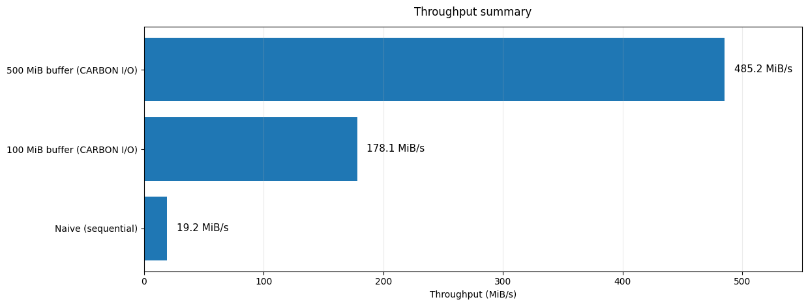
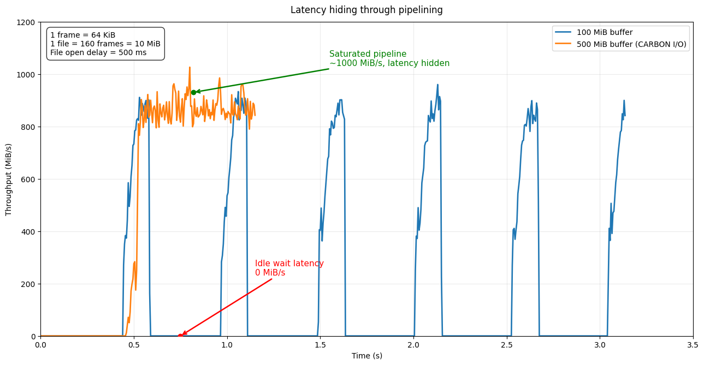

# CARBON I/O

[](https://crates.io/crates/carbon-io)
[](https://docs.rs/carbon-io)
[](https://github.com/theking90000/carbon-io/blob/main/LICENSE)
[](https://github.com/theking90000/carbon-io/blob/main/Cargo.toml)

**Concurrent Async Reordering Buffered Ordered Nonblocking I/O**

CARBON I/O is a Rust library for reading and writing several files concurrently
with bounded buffering and ordered output.

Each file contains frames of your chosen Rust type. CARBON schedules reads and
writes across files, limits buffering, and delivers results in order.

- `ReadScheduler` reads files into a stream of frames in file order.
- `WriteScheduler` fills frames from borrowed input, writes them to destinations,
  and returns close results in destination order.

Polling drives I/O. CARBON starts no background tasks.

Schedulers borrow a shared `&FrameBudget` and a mutable `&mut SchedulerConfig`.
Reads admit files directly with `push_file()`. Writes also borrow a frame allocator;
`poll_write()` fills its partial frame and reports completed files to replace.
The producer retains its sources and drives input and output in the same task.
Dropping a scheduler cancels its operations and releases its budget.
`set_window()` updates the caller's configuration.

See the [detailed guide](docs/guide.md) for more on scheduling, buffering,
backpressure, and backend integration.

## Hiding I/O latency

**25× the sequential throughput in this test:** 485.2 MiB/s with CARBON I/O,
versus 19.2 MiB/s sequentially. The smaller pipeline reached 178.1 MiB/s.

Test conditions: a 588 MB source file, split into 10 MiB segments of 160 frames
at 64 KiB each, with an artificial 500 ms delay per file open. The two runs
allowed 10 or 50 active files, covering 100 or 500 MiB of data ahead, with the
same 4,000-frame buffering budget, equivalent to 250 MiB. The charts' “buffer”
labels refer to that file window, not measured memory usage. These historical
measurements predate the direct frame-polling read API.




## Installation

Add to your `Cargo.toml`:

```toml
[dependencies]
carbon-io = "0.5.0"
futures = "0.3" # StreamExt, select! and the executor used in the examples.
```

Requires Rust 1.85 or newer. Works with any compatible async runtime.
The Tokio snippets below require Tokio.

## Reading files

`ReadFile<T>` opens and reads on the same object. Each file declares an exact,
nonzero frame count. `poll_read(cx, &mut T)` returns `Some(())` for a complete
frame and `None` for EOF. The backend owns its preparation state and offsets;
CARBON treats each buffer as opaque. It stops reading at the declared count,
without polling for EOF. An earlier `None` is a contract error; extra frames
are never polled.

Supply a buffer factory, the shared budget, and mutable configuration to
`ReadScheduler::new`. Pass `&mut factory` to borrow the factory. `push_file`
accepts a descriptor immediately or returns `(PushError, file)`. A full window
preserves the scheduler; retain the returned descriptor and retry after polling.
`close_files()` ends admission and allows EOF after all accepted files drain.

`ReadScheduler::poll_read(cx, &mut output)` exchanges the next complete frame
with the supplied reusable buffer. Heap-backed payloads such as `Vec<u8>` are
not copied. Each successful result transfers that frame to the caller, outside
CARBON's budget.

```rust
use std::{convert::Infallible, error::Error, future::poll_fn, pin::Pin, task::{Context, Poll}};
use futures::executor::block_on;
use carbon_io::{FrameBudget, ReadFile, ReadScheduler, SchedulerConfig};

struct File { count: u32, next: u32 }
impl ReadFile<u32> for File {
    type Error = Infallible;
    fn frame_count(&self) -> u32 { self.count }
    fn poll_open(self: Pin<&mut Self>, _: &mut Context<'_>) -> Poll<Result<(), Infallible>> {
        Poll::Ready(Ok(()))
    }
    fn poll_read(self: Pin<&mut Self>, _: &mut Context<'_>, frame: &mut u32)
        -> Poll<Result<Option<()>, Infallible>>
    {
        let this = self.get_mut();
        if this.next == this.count { return Poll::Ready(Ok(None)); }
        *frame = this.next;
        this.next = this.next.saturating_add(1);
        Poll::Ready(Ok(Some(())))
    }
}

fn main() -> Result<(), Box<dyn Error>> {
    block_on(async {
        let budget = FrameBudget::new(16);
        let mut config = SchedulerConfig::default();
        let mut make_frame = || 0;
        let mut reader = ReadScheduler::new(&mut make_frame, &budget, &mut config)?;
        reader.push_file(File { count: 3, next: 0 }).map_err(|(error, _)| error)?;
        reader.close_files();
        let mut frame = 0;
        while poll_fn(|cx| reader.poll_read(cx, &mut frame)).await?.is_some() {
            println!("{frame}");
        }
        Ok(())
    })
}
```

An empty input remains `Pending` while admission is open. It registers no waker
and requests no budget. `push_file()`, `close_files()`, and `set_window()` do not
wake a task: explicitly poll again after changing the scheduler. A producer
waiting for external descriptors must arrange its own wakeup. A combined producer
and consumer must retry a retained descriptor after a poll frees admission, then
repoll or schedule another poll after that successful push.

Opening ahead and buffering remain separate. With a 100-frame first file,
`open_ahead_frames = 120`, and `target_frames = 10`, the second file may open
immediately. Its first frame becomes authorized after 91 frames have been
consumed. Within the authorized window, different files may finish out of order;
CARBON returns complete frames in file order.

Both `poll_read()` and `poll_progress()` advance I/O. To continue preparing frames
while a consumer waits, poll `progress()` alongside that wait:

```ignore
while poll_fn(|cx| reader.poll_read(cx, &mut frame)).await?.is_some() {
    tokio::select! {
        result = send_frame(&frame) => result?,
        _ = reader.progress() => return Err("progress unexpectedly completed".into()),
    }
}
```

`progress()` never completes and consumes no output. Once the authorized window
is full, no further data is prepared. No background task is created.

## Writing files

Implement `WriteFile<T>` for a destination that opens, writes borrowed frames,
and closes on the same object. A `FrameAllocator` creates empty partial frames;
`PartialFrame` fills them from borrowed input. `BytesFrameAllocator` provides
fixed-size byte frames.

Fill the destination window with `push_file()`. Each `poll_write()` reports input
consumption, completed files at the head, and missing descriptors. Replace
completed heads with `pop_swap()` to recover their descriptors and close results
while appending new destinations. When input ends, use `poll_close()` and
`pop_file()` to drain the remaining results without supplying replacements.

```rust
use std::{convert::Infallible, error::Error, future::poll_fn, pin::Pin, task::{Context, Poll}};
use futures::executor::block_on;
use carbon_io::{AsyncFilesWrite, BytesFrameAllocator, FrameBudget, SchedulerConfig, WriteFile, WriteScheduler};

#[derive(Default)]
struct File(Vec<u8>);
impl WriteFile<Vec<u8>> for File {
    type Error = Infallible;
    type Output = Vec<u8>;
    fn frame_capacity(&self) -> u32 { 2 }
    fn poll_open(self: Pin<&mut Self>, _: &mut Context<'_>) -> Poll<Result<(), Infallible>> {
        self.get_mut().0.clear();
        Poll::Ready(Ok(()))
    }
    fn poll_write(self: Pin<&mut Self>, _: &mut Context<'_>, frame: &Vec<u8>)
        -> Poll<Result<(), Infallible>>
    {
        self.get_mut().0.extend_from_slice(frame);
        Poll::Ready(Ok(()))
    }
    fn poll_close(self: Pin<&mut Self>, _: &mut Context<'_>) -> Poll<Result<Vec<u8>, Infallible>> {
        Poll::Ready(Ok(std::mem::take(&mut self.get_mut().0)))
    }
}

fn main() -> Result<(), Box<dyn Error>> {
    block_on(async {
        let budget = FrameBudget::new(64);
        let mut config = SchedulerConfig::default();
        config.window.max_active_files = 1;
        let mut allocator = BytesFrameAllocator::new(3)?;
        let mut writer = WriteScheduler::new(&mut allocator, &budget, &mut config)?;
        writer.push_file(File::default())?;
        let mut input = &b"abcdefg"[..];
        let mut results = Vec::new();
        while !input.is_empty() {
            let status = poll_fn(|cx| Pin::new(&mut writer).poll_write(cx, input)).await?;
            for _ in 0..status.completed_files {
                let (_, result) = writer.pop_swap(File::default())?;
                results.push(result);
            }
            if let Some(consumed) = status.output { input = &input[consumed..]; }
        }
        loop {
            let completed = poll_fn(|cx| Pin::new(&mut writer).poll_close(cx)).await?;
            if completed == 0 { break; }
            for _ in 0..completed {
                results.push(writer.pop_file()?.unwrap().1);
            }
        }
        assert_eq!(results, [b"abcdef".to_vec(), b"g".to_vec()]);
        Ok(())
    })
}
```

Input frames fill destinations in order, up to each destination's capacity.
Destinations open only after receiving a frame. Closing flushes a nonempty
partial frame; empty input opens no file. If `poll_write()` returns `Pending`,
input remains unconsumed and the supplied waker signals when polling can resume.

## Choosing the window and budget

`SchedulerConfig` holds a `Window` and a retry count. The window determines how
far the scheduler may work ahead of the consumer:

| Window field | Default | Controls |
| --- | ---: | --- |
| `target_frames` | 256 | Desired local frame capacity |
| `open_ahead_frames` | 1024 | How far ahead, in frames, files may be discovered |
| `max_active_files` | 16 | Maximum active files, including unopened write destinations |

`FrameBudget` limits capacity across schedulers. Clone it to share one budget.
It counts scheduler-owned frames and reservations, not bytes, backend buffers,
frames already handed to the consumer, or completed write results.

When a writer pulls from a reader sharing the same budget, leave enough capacity
for both to progress, or the pipeline can deadlock.

Use `set_window(window)` to change either scheduler's window. Shrinking preserves
already authorized frames and opened files, then takes effect as work drains.
Allocated buffer storage does not shrink.

Frame counts, destination capacities, the global budget, `target_frames`, and
`max_active_files` must be nonzero. Invalid configurations and file contracts
are reported by scheduler operations.

## Retries, errors, and cancellation

`max_retries` defaults to zero and counts additional attempts per file. Reads
retry opening failures only. A reader error or early EOF is fatal.
Writes can retry opening, writing, or finalizing, with one shared retry count
across those stages.

Write retries change how long frames must be retained:

| Retry setting | Frame lifetime | Capacity requirement |
| --- | --- | --- |
| `max_retries == 0` | Drop each frame after a successful `poll_write` | A file may exceed the global frame budget |
| `max_retries > 0` | Retain the whole file until successful finalization | Reserve the whole file before accepting its first frame; it must fit the global budget |

A write retry reopens the same file object and replays from the
first retained frame. Reservations may exceed `target_frames` to fit one file.
There is no global rollback if an earlier file fails.

A fatal error releases scheduler resources immediately. Reads emit the error
once, then return EOF. Writes return the error from the current poll and reject
later operations with `InputClosed`.

Dropping a pending read or a `progress()` future preserves the scheduler's
state. Dropping the scheduler abandons its operations and releases its resources.
It does not undo writes. Backends must clean up abandoned attempts.

## Integrating a backend

`ReadScheduler` uses direct polling and does not implement `Stream`.

| Entry point | Behavior |
| --- | --- |
| `push_file(file)` | Admit immediately or return the descriptor without polling or waking |
| `close_files()` | End admission; explicitly poll again |
| `poll_read(cx, &mut frame)` | Advance I/O and exchange the next complete ordered frame |
| `poll_progress(cx)` | Advance I/O without consuming output; defer errors to `poll_read` |
| `progress()` | Never-completing future for progress during another wait |

Backends register the supplied waker before returning `Pending`. They receive
that context directly, with no slot wakers or ready queue. Each pending operation
is polled at most once per scheduler call. Work is limited to
`max(256, active_files)` backend polls, so even a configured window larger than
256 can register every file before waiting. Further runnable work schedules
another poll; pending-only work does not self-wake.

A pending read receives the same logical buffer with its contents preserved.
Its address may change. The backend must not retain its reference, and must
initialize recycled buffers when starting a new frame. CARBON has no partial-read
frame interface. A pending buffer still occupies one reserved frame slot.

After the declared final frame is handed to the caller, the file leaves the
active window and the returned buffer is available for reuse. No EOF buffer or
additional backend poll is needed. Idle recycled buffers retain their allocated
storage; the budget measures authorized operations and output, not cached bytes.

Files must be `Unpin` or supplied as `Pin<Box<F>>` or `Pin<&mut F>`. Frames need
neither `Clone`, `Send`, nor `Unpin`. Reads retry opening errors only. After an
opening error, the next `poll_open` starts a fresh attempt. Write backends also
restart after write or close errors, for replay from the first frame.

The crate contains no unsafe code and has no runtime dependencies.
`FramePermit::poll_grow` rejects invalid requests while preserving existing grants
and waits. Shared-budget synchronization remains unchanged.

## Examples and performance

Each example is an independent crate with its own dependencies and lockfile.
See the [examples guide](examples/README.md) for the memory, TCP/file, Reqwest,
and Pingora uploads and their launch commands.

The [memory example](https://github.com/theking90000/carbon-io/blob/main/examples/memory/src/main.rs)
reads frames, then writes them and collects file close results:

```sh
cargo run --locked --manifest-path examples/memory/Cargo.toml
```

See the [benchmark report](https://github.com/theking90000/carbon-io/blob/main/docs/benchmarks.md)
for in-memory throughput, backend polls, and allocations.

## Development

```sh
cargo test --locked
cargo test --locked --release
cargo fmt --all -- --check
cargo clippy --locked --all-targets -- -D warnings
cargo bench --locked --bench scheduler
```

The [original specification](https://github.com/theking90000/carbon-io/blob/main/docs/specification.md) contains the French CDC and its
V1 amendments.

MIT licensed.
